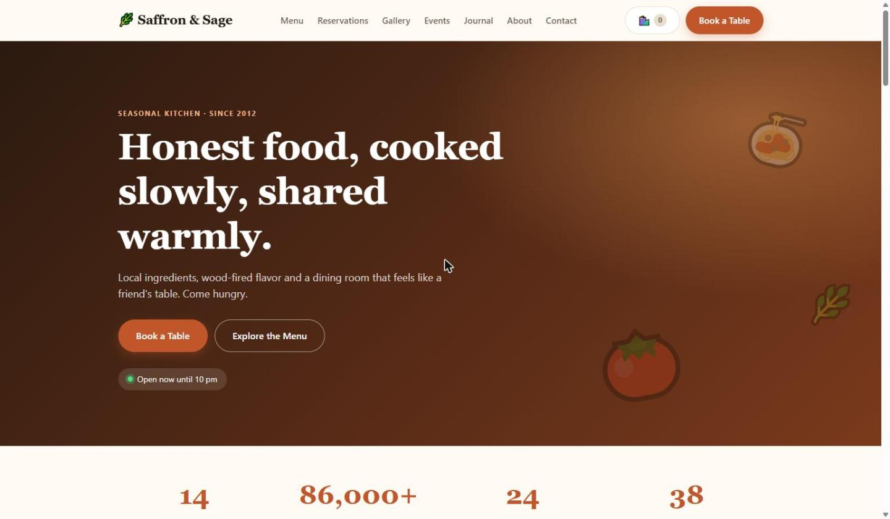

# 🌿 Saffron & Sage: Free Restaurant Website Template

A free, responsive, multi-page restaurant website template built with plain **HTML, CSS and JavaScript**. No frameworks, no build step, no dependencies.

**[Live demo](https://lenivalestevao.github.io/restaurant-menu-landing-page/)**



## What is inside

- **Home:** hero with an "open now" indicator, animated stats, favorites carousel, reviews carousel, events, gallery strip and journal
- **Menu:** 24 dishes with category chips, dietary filters (vegetarian, vegan, gluten-free, spicy) and search
- **Dish pages** with related dishes
- **Online ordering:** cart saved in the browser, pickup or delivery, tip, tax, delivery fee, order confirmation
- **Reservations:** date picker, time slots that change with opening hours (closed days handled), confirmation page
- **Gallery** with filters and a keyboard-friendly lightbox
- **Events:** private dining types, upcoming events and an inquiry form
- **Journal:** list and article pages
- **Reviews** with rating breakdown, **gift cards**, **about**, **contact** with opening hours, **FAQ**, privacy and terms
- Responsive mobile menu, toasts, 404 page

19 page types in total, all rendered in the browser with hash routing (for example `#/menu`, `#/dish/6`, `#/reserve`), so it works on any static host, including GitHub Pages.

## Files

| File | Purpose |
| --- | --- |
| `index.html` | Header, footer and the page container |
| `style.css` | All styles. Change the colors in `:root` |
| `script.js` | Data, pages, router and behavior |

## Customize

1. Rename the brand in `index.html` and `script.js`.
2. Replace the demo data at the top of `script.js`: `DISHES`, `REVIEWS`, `EVENT_TYPES`, `UPCOMING`, `POSTS`, `GALLERY`, `TEAM`, `FAQ` and `HOURS`.
3. Change the colors with the CSS variables in `:root` of `style.css`.
4. Dishes and gallery use emojis on gradient tiles so there are no image files. Swap them for real photos with `` tags.
5. Edit the address, phone and email in `index.html` and `script.js`.

## Run it

Open `index.html` in a browser, or serve the folder:

```bash
npx serve .
```

## Notes

- Ordering, reservations and gift cards are demos. Nothing is sent to a server and no payment is taken. Connect your own backend or a service such as a booking or payments provider.
- The data is kept in your browser's localStorage and falls back to memory when storage is blocked.
- Names, prices, reviews and events are fictional.

## License

MIT. Use it for personal and commercial projects.
